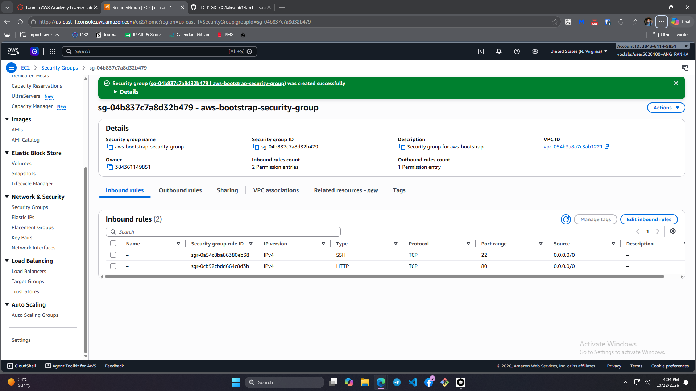
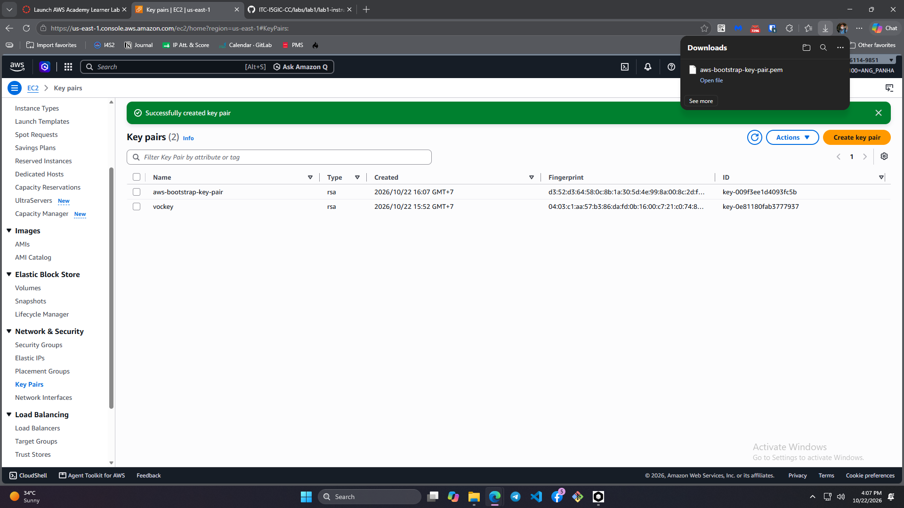
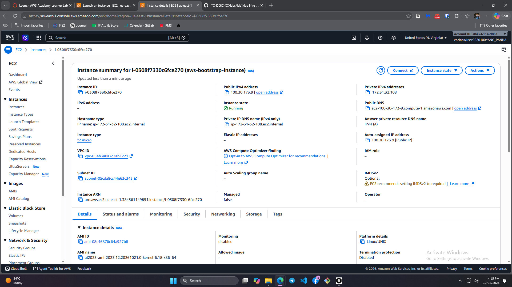
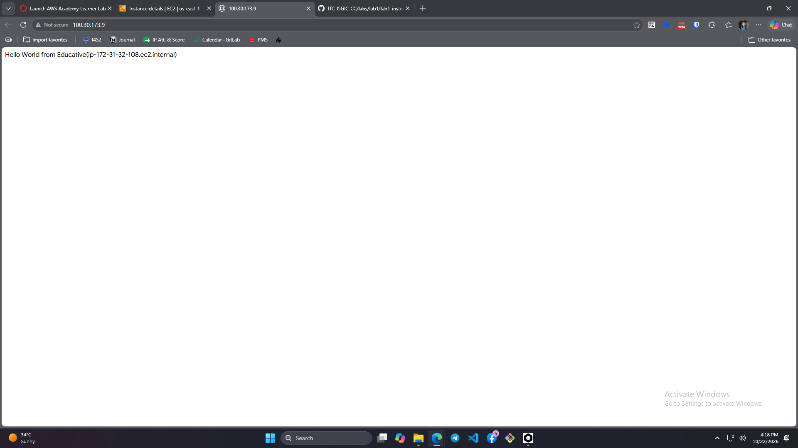
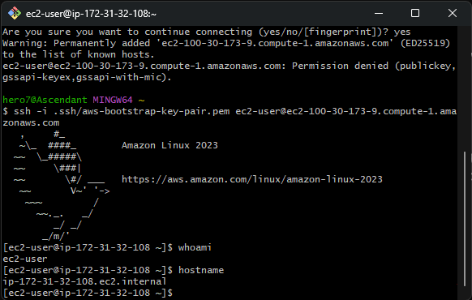
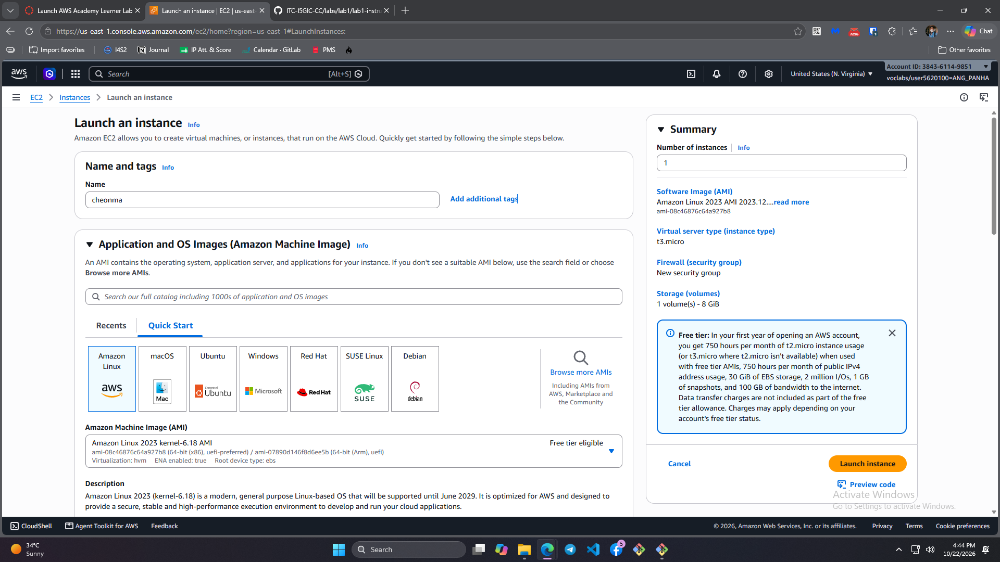
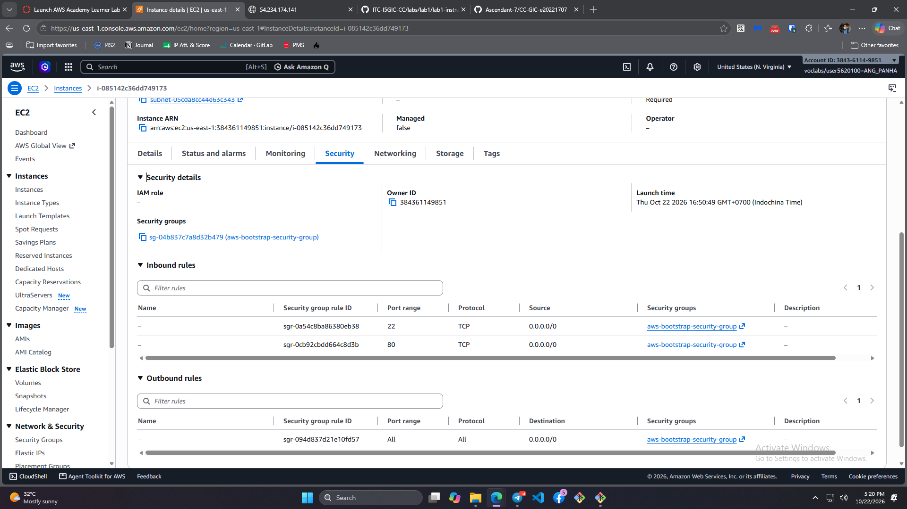
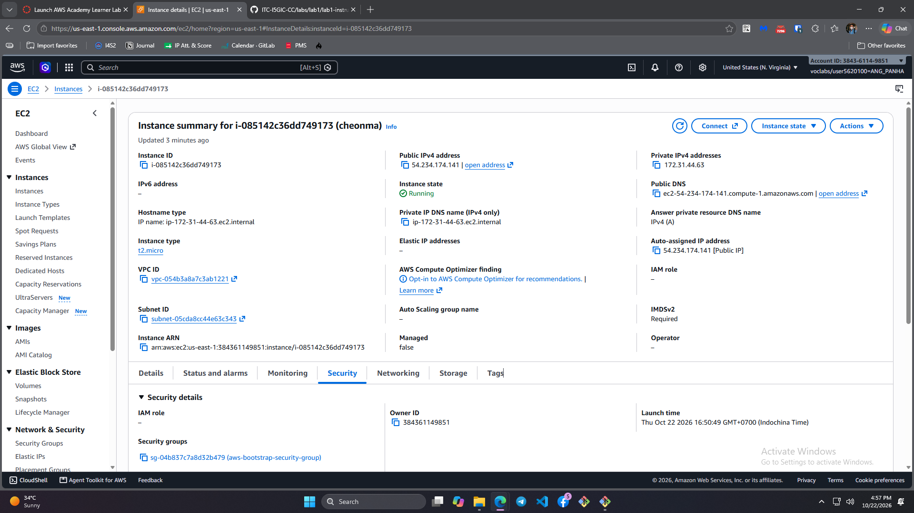
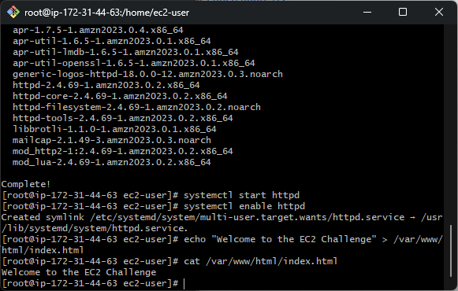
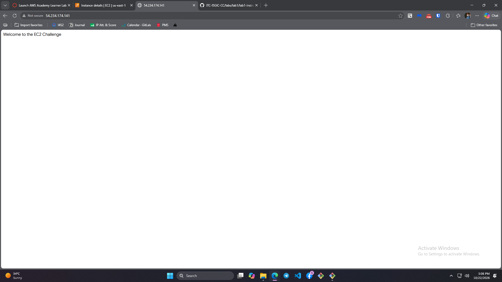

# Cloud Lab 1 — individual report

- **Student name:** Ang Panha
- **Student ID:** e20221707
- **Learner Lab user name** (top-right of the AWS console): user5620100=ANG_PANHA
- **Date completed:** 10/22/2026

---

## Task evidence

### 1. Security Group

This screenshot shows the security group I made which is called `aws-bootstrap-security-group` created. It worked because it allows incoming traffic on port 22 (**SSH**) and port 80 (**HTTP**) from `0.0.0.0/0` (Anywhere-IPv4).

---

### 2. Key Pair

This screenshot shows the key pair I made named `aws-bootstrap-key-pair` in the console. It worked because the private key file `aws-bootstrap-key-pair.pem` downloaded directly to my computer.

---

### 3. Instance Details (Walkthrough)

This screenshot shows the instance I launched called `aws-bootstrap-instance`. It worked because the status turned to **Running**, it's set as a **t2.micro**, and it successfully got a public IP address.

---

### 4. Browser Test (Walkthrough)

This screenshot shows my web browser loading the instance's public IP. It worked because the user data script ran automatically and displayed the `"Hello World from Educative"` page.

---

### 5. SSH Connection

This screenshot shows my terminal connected to the instance over SSH. It worked because when I ran `whoami` and `hostname`, it returned `ec2-user` and the internal IP.

---

### 6. Challenge Launch Configuration

This screenshot shows the setup page for my challenge instance named `Cheonma`. It worked because I selected the Amazon Linux 2023 AMI, a **t2.micro**, and increased the storage up to **10 GiB**.

---

### 7. Challenge Security Group

This screenshot shows the security group assigned to the challenge. It worked because it's using the same `aws-bootstrap-security-group` with ports 22 and 80 open.

---

### 8. Challenge Instance Details

This screenshot shows my challenge instance `Cheonma` in the list. It worked because it's showing as **Running** with a valid public IP.

---

### 9. Challenge Terminal Setup

This screenshot shows my terminal logged into `Cheonma`. It worked because I manually installed Apache, started it, and verified the custom message using the `cat` command.

---

### 10. Challenge Browser Test

This screenshot shows my browser opening the public IP of `Cheonma`. It worked because it loaded my custom **"Welcome to the EC2 Challenge"** page right on the screen.

---

## Questions

### Q1. Why do we need a security group, and what happens if you remove the HTTP rule?
A security group acts as a virtual stateful firewall at the instance level to control incoming and outgoing network traffic. If you remove the HTTP rule (port 80), any incoming web requests sent from a browser will be blocked by AWS at the network boundary, causing browser connections to time out without reaching the web server.

### Q2. Why is a key pair required for SSH access, and why should the `.pem` file never be committed to Git?
A key pair uses public-key cryptography to secure server logins instead of easily crackable passwords; AWS injects the public key into the instance while you retain the private key (`.pem`). The `.pem` file must never be committed to Git because anyone with access to your repository could use that private key to gain full administrative access to your virtual server.

### Q3. What is the role of the User Data script in Task 3?
The User Data script automates bootstrapping when an instance boots for the first time. It automatically elevates privileges, updates system packages, installs the Apache web server (`httpd`), enables the web service to start on boot, and populates the default `index.html` file without requiring manual SSH intervention.

---

## Problems and how I solved them

**Issue:** When attempting to SSH into the EC2 instance using PowerShell on Windows, the SSH client threw an error stating `UNPROTECTED PRIVATE KEY FILE!` and rejected the connection.

**Cause:** OpenSSH requires strict permissions on private key files (`.pem`). By default, Windows inherits broad read/write permissions for multiple user groups on files saved in default download directories.

**Solution:** I moved the `aws-bootstrap-key-pair.pem` file to `C:\Users\User\.ssh\`, opened the file **Properties -> Security -> Advanced**, disabled permission inheritance, removed all inherited permissions, and assigned **Full Control** strictly to my specific Windows user account.

---

## AI note

- **AI Suggestion:** Gemini helped format the Windows PowerShell SSH command syntax (`ssh -i "C:\Users\<User>\.ssh\aws-bootstrap-key-pair.pem" ec2-user@<DNS>`) specifically for connecting from a Windows desktop to the AWS Linux instance.
- **Verification:** I ran the PowerShell command in my terminal, successfully established the connection, and ran `whoami` to verify the `ec2-user` session before taking screenshot `05`.

---

## Clean up

- [x] I deleted every resource listed in the lab's Clean Up section.